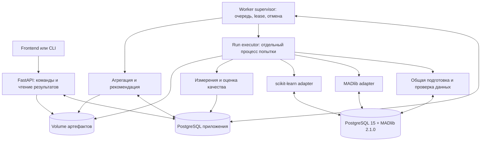

# Архитектура Python бэкенда и воркеров

> Этот документ описывает целевую архитектуру, включая ещё не реализованные компоненты. Актуальная карта модулей, контрактов и ограничений находится в [документации реализованных блоков](modules.md). В частности, пока нет automatic retry, отдельных finalize/cleanup jobs, полного CLI управления экспериментами и отдельных таблиц для метрик/артефактов. Frontend на Vue уже реализован.

Приложение сравнивает обучение и предсказание в PostgreSQL с Apache MADlib и в Python со scikit-learn на согласованных данных. Основной результат — воспроизводимый эксперимент с измерениями, метриками качества и объяснимой рекомендацией.

Предлагается модульный монолит: один Python-пакет, два постоянных процесса — API и worker — и отдельный дочерний процесс для каждой попытки запуска. PostgreSQL приложения хранит управляющее состояние и очередь; PostgreSQL с MADlib хранит экспериментальные данные. Эта граница позволяет развивать модули независимо без распределения бизнес-логики по микросервисам.

## Область первой версии

Исходный стек: Python 3.12, FastAPI, Pydantic, SQLAlchemy, Alembic, psycopg 3, NumPy, SciPy, scikit-learn, psutil, threadpoolctl. Стенд работает в Linux и Docker Compose. Экспериментальная СУБД — PostgreSQL 15.x с MADlib 2.1.0; точные версии библиотек и образы фиксируются после проверки совместимости.

Первый вертикальный сценарий: линейная регрессия без регуляризации, плотные числовые признаки, один целевой столбец, фиксированное train/test-разбиение, оба адаптера, повторы, RMSE и MAE, JSON-отчёт. Это проектное ограничение MVP. Бинарная классификация, категориальные признаки и большие матрицы добавляются следующими этапами.

Frontend использует HTTP-контракты, но его реализация не входит в этот план. Очередь PostgreSQL достаточна для начального стенда; отдельный брокер не требуется. Тяжёлые операции выполняет worker: документация FastAPI рассматривает их отдельно от обычных фоновых задач запроса. [FastAPI Background Tasks](https://fastapi.tiangolo.com/tutorial/background-tasks/)

## Процессы и потоки данных



**API** валидирует запросы, фиксирует конфигурацию, создаёт задания, возвращает статусы, принимает отмену и выдаёт зарегистрированные артефакты. API не загружает матрицы признаков, не обучает модели и не выполняет экспериментальный SQL.

**Worker supervisor** получает задание, резервирует стенд, запускает дочерний процесс, обновляет heartbeat, следит за тайм-аутами и отменой, фиксирует завершение. Отдельный цикл восстановления обрабатывает истёкшие аренды. В MVP он работает внутри worker; при нескольких воркерах каждое изменение защищено условным UPDATE.

**Run executor** выполняет одну попытку одного запуска: prepare → train → predict → persist_results → evaluation. Он открывает собственные соединения после старта; соединения SQLAlchemy/psycopg не передаются между процессами. Supervisor получает сообщения о фазах через IPC, но терминальное состояние публикует сам.

**CLI** вызывает те же прикладные сервисы: validate, submit, status, cancel, export. Обычный submit использует очередь. Отладочный локальный режим должен проходить ту же резервировку стенда и регистрацию попыток, чтобы не нарушать условия сравнения.

## Модули и зависимости

```text
src/ml_criterion/
  api/                  # app, routes, schemas, dependencies, error handlers
  domain/               # сущности, статусы, ошибки, типы контрактов
  application/          # сценарии create, enqueue, cancel, finalize
  datasets/             # версии, профили, проверка исходных таблиц
  preprocessing/        # разбиения, преобразования, prepared datasets
  experiments/          # спецификации, матрица запусков, парные повторы
  worker/               # supervisor, queue loop, executor, recovery
  backends/
    base.py             # Protocol адаптера и реестр capabilities
    madlib/             # SQL templates, mapping параметров, диагностика
    sklearn/            # загрузка, estimator factory, сериализация
  measurement/          # фазы, sampler, environment snapshot
  evaluation/           # полнота предсказаний и метрики качества
  recommendation/       # ограничения, сравнение, объяснения
  artifacts/            # файловое хранилище, manifest, экспорт
  persistence/          # модели SQLAlchemy, UoW, repositories, queue SQL
  infrastructure/       # подключения bench DB, конфигурация, логи
  cli.py
migrations/
tests/unit/
tests/integration/
tests/e2e/
deploy/
```

`domain` не зависит от FastAPI, SQLAlchemy или библиотек ML. `application` координирует предметные модули через интерфейсы репозиториев, очереди и адаптеров. `api`, `worker` и `cli` вызывают прикладные сценарии; инфраструктурные реализации подключаются в точках запуска. ORM-объекты не используются как публичные HTTP-схемы.

| Модуль | Вход и результат | Основное правило |
| --- | --- | --- |
| datasets | Зарегистрированная таблица → неизменяемая версия и профиль | У каждой строки есть уникальный row_id |
| preprocessing | Версия + рецепт + split → prepared_dataset | Преобразования обучаются только на train |
| experiments | ExperimentSpec → comparison cases и runs | Матрица и seed фиксируются до выполнения |
| worker | Job → попытки и конечный статус | Повтор задания не перезаписывает чужой результат |
| backends | RunContext → ModelRef и PredictionRef | Не решают, кто победил в сравнении |
| measurement | События фаз → длительности и ресурсы | Область измерения явно записана |
| evaluation | PredictionRef + эталоны → метрики | Сначала проверяется соответствие row_id |
| recommendation | Валидные парные результаты → решение | Может вернуть «недостаточно данных» |
| artifacts | Файл + manifest → ArtifactRef | API выдаёт только опубликованные файлы |
| persistence | Команды → атомарные изменения метаданных | Нет общей транзакции с bench DB и volume |

## Модель метаданных

Разделяются эксперимент, логический запуск и техническая попытка. Повтор измерения — новый run; повтор после аварии — новый attempt того же run.

| Сущность | Ключевые данные |
| --- | --- |
| dataset | Название, назначение, источник |
| dataset_version | Snapshot/table reference, схема, row_count, checksum, профиль, состояние |
| prepared_dataset | Dataset version, split manifest, рецепт и его версия, порядок признаков, параметры преобразований, ссылки на таблицы |
| experiment | Неизменяемый spec JSONB, schema_version, config_hash, статус, cancel_requested_at |
| comparison_case | Dataset/prepared version, модель, параметры, ресурсы, seed и политика измерений |
| run | Case, backend, repeat_index, pair_id, порядок выполнения, warmup flag, статус |
| run_attempt | Run, attempt_no, fencing_token, фаза, времена, код ошибки, диагностика, bench session identity |
| job | Тип, payload_version, entity_id, state, priority, available_at, owner, lease_until, token, attempts |
| worker | Идентификатор, heartbeat, capabilities, активная попытка |
| benchmark_slot | Идентификатор стенда, владелец, срок аренды, token, состояние available/busy/quarantined |
| measurement | Attempt, scope, phase, metric, value, unit, method, sampling interval |
| quality_metric | Attempt, metric, value либо undefined с причиной, evaluation_version |
| environment_snapshot | Версии Python/ML/СУБД, образ, CPU, память, настройки потоков и PostgreSQL |
| artifact | Attempt/experiment, относительный ключ, тип, размер, checksum, state |
| recommendation | Experiment, policy_version, входные attempts, verdict, причины, агрегаты |
| event | Experiment/run/attempt, тип события, время, структурированные данные |

FK связывают сущности; уникальные ограничения защищают `(run_id, attempt_no)`, `(case_id, backend, repeat_index, warmup)` и логический ключ job. Для готовой версии данных после изменения источника требуется новая версия. Статусы, даты и поля поиска — обычные колонки; spec и backend-specific diagnostics — JSONB.

В bench DB выделяются схемы для snapshots, prepared datasets и объектов попыток. Объекты создаются с серверными именами на основе UUID. Для MVP materialized snapshot предпочтительнее ссылки на изменяемую исходную таблицу. Копирование выполняется в согласованном снимке; row_id, число строк и fingerprint фиксируются до публикации версии.

## Очередь и восстановление

Типы заданий: `prepare_dataset`, `execute_run`, `finalize_experiment`, `cleanup_attempt`. Для каждого есть отдельный handler; транспорт и жизненный цикл общие. Начальный worker может выполнять все типы, но одновременно допускается только одна нагрузка на экспериментальный стенд, включая тяжёлую подготовку данных.

Создание experiment и начального job выполняется одной транзакцией в управляющей БД. Готовность зависимостей проверяется при планировании; prepare публикует prepared_dataset и создаёт run jobs идемпотентно. Последний завершённый run инициирует finalize с уникальным ключом.

Захват job использует короткую транзакцию с `SELECT ... FOR UPDATE SKIP LOCKED`, затем UPDATE владельца, token и lease. Длительная работа начинается после COMMIT. PostgreSQL прямо допускает SKIP LOCKED для нескольких потребителей очереди. [PostgreSQL 15 SELECT](https://www.postgresql.org/docs/15/sql-select.html)

1. Supervisor атомарно получает доступный job и, если нужен, benchmark_slot. Если слота нет, задание остаётся доступным с задержкой следующей проверки.
2. Создаёт attempt и запускает executor. Проектные начальные значения: heartbeat каждые 5 секунд, lease 30 секунд; настройки подлежат проверке отказами.
3. Продлевает lease отдельным соединением с условиями owner/token/state. Время аренды рассчитывается по часам управляющей БД.
4. После успешного executor публикует результаты только при сохранённом владении job и слотом. Обновление run, job и связанных записей метаданных атомарно.
5. Recovery переводит просроченную попытку в interrupted. Новый attempt получает новый token и собственное пространство SQL-объектов и файлов.

Семантика доставки — at least once. Fencing token запрещает устаревшему исполнителю публиковать результат, но сам по себе не останавливает его SQL или вычисления. При потере lease supervisor останавливает дочерний процесс и отменяет bench-запрос; если остановку подтвердить нельзя, слот становится quarantined. Recovery не запускает следующую нагрузку до проверки отсутствия старой сессии и процесса. Неопределённость устраняется остановкой соответствующего executor-контейнера либо оператором, а не слепым повтором.

Все записи попытки используют attempt_id и token. Из двух конкурирующих завершений принимается только актуальное. Измерения аварийной попытки сохраняются для диагностики, но не включаются в сравнение. Начальная политика — не более двух автоматических повторов после временного инфраструктурного сбоя с backoff. Ошибки данных, неподдерживаемые параметры, timeout и исчерпание памяти автоматически не повторяются с изменёнными условиями.

### Состояния и отмена

Experiment: `draft → queued → preparing → running → finalizing → succeeded | partial | failed`; отмена переводит активный эксперимент через `cancelling` в `cancelled`. `partial` означает наличие законченных валидных результатов и обязательных неуспешных запусков; полноценная рекомендация при этом не гарантируется.

Run: `pending → queued → running → succeeded | failed | cancelled`. Инфраструктурный повтор может вернуть run в queued; история остаётся в attempts. Attempt: `running → succeeded | failed | cancelled | interrupted`. Job: `queued → leased → succeeded | failed | cancelled`; повтор создаётся переводом в queued с новым token при следующем захвате.

Отмена — сохраняемый запрос, а не немедленное обещание остановки. API идемпотентно устанавливает cancel_requested_at. Worker отменяет queued jobs, посылает сигнал исполнителю, отменяет собственный PostgreSQL-запрос и после grace period завершает дерево дочерних процессов. Для SQL задаются statement_timeout и lock_timeout. PID сессии проверяется вместе с backend_start и application_name, чтобы не затронуть повторно использованный PID. Если остановка не подтверждена, статус остаётся cancelling и стенд изолируется. Финальная публикация проверяет отмену в той же транзакции: уже завершённый эксперимент отменой не переоткрывается.

## Контракт адаптеров

```python
class BackendAdapter(Protocol):
    def validate(self, spec: RunSpec, capabilities: Capabilities) -> ValidationResult: ...
    def prepare(self, context: RunContext) -> PreparedContext: ...
    def train(self, context: PreparedContext) -> ModelRef: ...
    def predict(self, context: PreparedContext, model: ModelRef) -> PredictionRef: ...
    def persist_results(self, context: PreparedContext,
                        predictions: PredictionRef) -> PersistedResult: ...
    def collect_diagnostics(self, context: PreparedContext) -> Diagnostics: ...
    def cleanup(self, context: RunContext) -> CleanupResult: ...
```

Это эскиз интерфейса, не готовый код. RunContext содержит immutable spec, prepared_dataset reference, attempt_id, объект проверки отмены и подключения. Сами массивы и ORM-сессии не передаются между процессами.

ModelRef описывает тип хранилища, ключ и формат. PredictionRef может ссылаться на временный массив или таблицу; persist_results приводит его к общему контракту в bench DB: `(attempt_id, row_id, y_pred, probability)`. Для регрессии probability отсутствует. Метки классов и соответствие вероятностей фиксируются отдельно. Порядок строк не заменяет row_id.

MADlib хранит модель в таблицах и при необходимости экспортирует коэффициенты и metadata. scikit-learn создаёт артефакт с версиями зависимостей. Общий ModelRef не обещает переносимость моделей между подходами. Cleanup удаляет только зарегистрированные временные объекты конкретной попытки; опубликованные модели, predictions и shared prepared datasets имеют отдельную политику хранения.

SQLAlchemy используется для metadata. В адаптерах и подготовке — psycopg 3 и явный SQL. SQL-значения параметризуются, идентификаторы составляются безопасным SQL Identifier API. HTTP принимает идентификатор зарегистрированного источника и декларативную конфигурацию, а не произвольный SQL.

Capabilities фиксируют реально проверенные пары «алгоритм — backend — версия». Регуляризация, intercept, solver, tolerance, max_iter, dtype и обработка NULL согласуются явно. Одинаковое название алгоритма не означает одинаковую оптимизационную задачу или численно идентичный результат.

## Сопоставимость данных и измерений

### Общая подготовка

Один preprocessing-модуль создаёт immutable prepared_dataset для обоих адаптеров: train/test принадлежность по row_id, упорядоченный список признаков, dtype, label mapping и параметры преобразований. Seed дополняет сохранённое разбиение, но не заменяет его. Статистики заполнения пропусков и масштабирования вычисляются по train, затем применяются к test. Это исключает утечку информации из тестовой выборки. [scikit-learn Common pitfalls](https://scikit-learn.org/stable/common_pitfalls.html)

В MVP пропуски и категориальные признаки отклоняются с понятной ошибкой. Позднее imputer и encoder получают версионируемые рецепты. Python-конвейер не должен повторно масштабировать уже подготовленные общие признаки. Если исследуется скорость самих способов подготовки, это отдельный тип эксперимента.

### Границы времени

| Фаза | MADlib | scikit-learn |
| --- | --- | --- |
| common_prepare | Общая материализация и преобразования, один раз на prepared_dataset | Та же подготовка |
| backend_prepare | Подготовка backend-specific объектов | Запрос, передача признаков, преобразование в массивы |
| train | Вызов обучения и завершение нужной транзакции | fit |
| predict | SQL-предсказание с завершённой материализацией | predict / predict_proba |
| persist_results | Публикация таблицы предсказаний | Передача и фиксация предсказаний в bench DB |
| evaluate | Общая проверка и расчёт метрик | Тот же evaluator |
| export | Модели, manifest и отчёт | Модели, manifest и отчёт |

`model_wall_ns` — отдельный внешний таймер от начала backend_prepare до завершённого persist_results. Так обе ветки стартуют с одних данных в PostgreSQL и заканчиваются предсказаниями в PostgreSQL. `train_wall_ns` публикуется отдельно; SQL train включает наблюдаемые клиентом накладные расходы и не называется чистым CPU-временем алгоритма. common_prepare, ожидание очереди, запуск процесса, evaluate и export не входят в model_wall_ns и показываются отдельно. Дополнительно хранится полное пользовательское время от submit до готовности отчёта.

Таймеры используют perf_counter_ns; календарные timestamps хранятся в UTC для истории. Сумма фаз служит проверкой, но не заменяет внешнее время. Каждый повтор запускается в новом процессе. Порядок backend внутри пар чередуется или рандомизируется заранее; warmup явно помечается и исключается из основной статистики. Холодный кеш не заявляется без отдельной управляемой процедуры. Сохраняется фактическая политика кеширования.

### Ресурсы

psutil измеряет executor и его дочерние процессы. Для MADlib это только клиентская часть: ресурсы PostgreSQL фиксируются отдельно на уровне bench-контейнера/cgroup. Для Python также фиксируются ресурсы bench DB, обслуживающей чтение и запись. Отчёт показывает обе области и не сравнивает RSS клиента MADlib с RSS всего Python-обучения как равные величины.

Начальная частота сэмплирования — 100–250 мс, с записью фактического интервала и пропусков. Пик по выборке является приближением. RSS, cgroup memory и CPU seconds имеют разные определения и не складываются без явной методики. Недоступная метрика обозначается unavailable; её нельзя подменять нулём. Контейнерные счётчики включают фоновую активность СУБД, что указывается в scope.

Фиксируются лимиты CPU/RAM, n_jobs, BLAS/OpenMP, threadpoolctl, версия BLAS, настройки parallel query и память PostgreSQL. n_jobs не управляет всеми внутренними потоками: scikit-learn отдельно описывает joblib, OpenMP и BLAS. [scikit-learn Parallelism](https://scikit-learn.org/stable/computing/parallelism.html)

Один benchmark_slot гарантирует отсутствие конкурирующих экспериментов на стенде. Масштабирование worker на том же стенде не увеличивает параллелизм измеряемых задач. Параллельные эксперименты требуют отдельных изолированных стендов. До загрузки данных sklearn проверяет оценку памяти с учётом копий и алгоритма; неподходящий запуск отклоняется, а не незаметно переводится на другой алгоритм.

## Качество и рекомендация

Evaluator проверяет точное совпадение множества test row_id, уникальность предсказаний, отсутствие лишних строк, NaN/Inf и корректность вероятностей. Затем считает общие метрики: RMSE/MAE для регрессии; на следующем этапе accuracy, F1, ROC AUC и log loss для бинарной классификации. Неопределённая метрика получает причину, например отсутствие одного из классов в test.

Рекомендация относится только к измеренной конфигурации. Политика заранее задаёт основную метрику качества, допустимую потерю качества, предел памяти/времени и минимальный практически значимый выигрыш. Подбор параметров требует отдельной validation-выборки; test не используется для оптимизации конфигурации.

Сначала исключаются невалидные результаты, затем проверяются ограничения, затем сравниваются парные длительности. Используются только пары с успешными попытками обоих backend; сохраняются число исключённых пар и причины. Показываются медианы, разброс и отношения времени в каждой паре. Доверительные интервалы, если реализованы, рассчитываются с парным resampling. Малое число повторов и высокий разброс допускают verdict `inconclusive`.

В MVP можно задать пять измеряемых пар как стартовую конфигурацию, но это не гарантия статистической достоверности. Возможные решения: madlib, sklearn, comparable, inconclusive, no_feasible_backend. Рекомендация хранит версию политики, численные основания и scope; универсальный взвешенный балл без объяснения не используется.

## HTTP API

| Метод и путь | Назначение |
| --- | --- |
| GET /api/v1/capabilities | Проверенные модели, параметры и возможности стенда |
| POST /api/v1/datasets | Регистрация разрешённого источника |
| POST /api/v1/datasets/{id}/versions | Асинхронный snapshot и профиль |
| GET /api/v1/dataset-versions/{id} | Готовность и профиль версии |
| POST /api/v1/experiments/validate | Проверка spec и размера матрицы |
| POST /api/v1/experiments | Создание immutable конфигурации |
| POST /api/v1/experiments/{id}/start | Постановка в очередь, ответ 202 |
| GET /api/v1/experiments/{id} | Статус, текущая фаза и счётчики запусков |
| GET /api/v1/experiments/{id}/runs | Запуски и попытки с пагинацией |
| POST /api/v1/experiments/{id}/cancel | Идемпотентный запрос отмены |
| GET /api/v1/experiments/{id}/results | Измерения, качество и агрегаты |
| GET /api/v1/experiments/{id}/recommendation | Решение и объяснение |
| GET /api/v1/experiments/{id}/artifacts | Доступные файлы |
| GET /api/v1/artifacts/{id}/download | Проверенная выдача артефакта |
| GET /health/live и /health/ready | Жизнеспособность API и готовность metadata |

Для create/start поддерживается Idempotency-Key: одинаковый ключ с одинаковым телом возвращает тот же результат, с другим телом — 409. Неподдерживаемая спецификация — 422; неправильный переход состояния — 409. Асинхронные сбои видны в статусе и структурированной ошибке с code, phase, retryable и безопасным сообщением. Polling достаточен для MVP; SSE можно добавить поверх event.

Прогресс показывает завершённые runs и текущую фазу; процент обучения не выдумывается. Готовность API не зависит от доступности MADlib, чтобы историю и сбои можно было читать при падении стенда. Состояние стенда отражается отдельно в capabilities и preflight.

## Артефакты и согласованность

Файлы располагаются по ключу `experiments/{experiment_id}/runs/{run_id}/attempts/{attempt_id}/`. Пишутся во временный файл на том же volume, проверяются по размеру/checksum, затем атомарно переименовываются. Только после этого метаданные помечаются ready при проверке актуального token. API имеет read-only mount и разрешает пути только внутри корня volume.

Между metadata DB, bench DB и файлами нет общей транзакции. Используется staged → ready публикация с manifest. Если worker упал между созданием файла/таблицы и фиксацией метаданных, recovery сверяет manifest и владельца, затем завершает публикацию или регистрирует сиротский объект для уборки. Cleanup идемпотентен и не удаляет объекты активных lease или общие данные с действующими ссылками. Ошибка cleanup записывается отдельно от успешного результата эксперимента.

Минимальные артефакты: исходная spec, resolved параметры, environment snapshot, split/feature manifest, measurements, quality metrics, diagnostics, recommendation и модель. Полные предсказания могут оставаться таблицей; CSV-экспорт запрашивается отдельно.

## Развёртывание и эксплуатация

Compose включает metadata-db, bench-db, api, worker и одноразовый migrate. Volume метаданных, volume bench DB и volume артефактов независимы. API и worker могут использовать один образ, но запускаются разными командами. Ресурсные лимиты и точные теги/дижесты фиксируются. Python 3.12 относится к приложению; окружение сборки и выполнения расширения MADlib проверяется отдельно внутри bench-образа.

Preflight проверяет версии, наличие нужных MADlib-функций, права на служебные схемы, свободное место, доступность volume и ресурсного мониторинга. Совместимость PostgreSQL 15 и MADlib 2.1.0 проверяется сборкой и smoke-тестом конкретного образа; в Apache есть пример их совместной сборки, но он не заменяет тест выбранного Linux-окружения. [Apache MADLIB-1518](https://issues.apache.org/jira/browse/MADLIB-1518)

Структурированные логи включают experiment_id, run_id, attempt_id, worker_id, фазу и код ошибки. Служебные показатели: длина очереди, возраст старейшего задания, lease expirations, stalled attempts, failed cleanup и доступность стенда. Секреты подключения не включаются в spec, логи и отчёт. Для локального MVP доступ ограничивается localhost/закрытой сетью; внешний доступ требует аутентификации и проверки владельца ресурсов.
